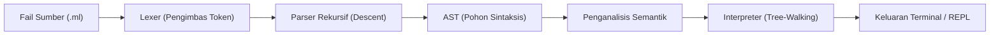

<div align="center">

  <a href="https://github.com/rillardian655/Melayu-Language-by-runa">
    
  </a>

  <br/><br/>

  <a href="https://github.com/rillardian655/Melayu-Language-by-runa">
    
  </a>

  <p align="center">
    <b>Bahasa pengaturcaraan serumpun bertaraf pengeluaran untuk pembangun Nusantara.</b><br/>
    <i>Direka untuk Indonesia, Malaysia, Brunei, dan Singapura. Dibina dari sifar menggunakan Rust.</i>
  </p>

  <p align="center">
    <a href="https://github.com/rillardian655/Melayu-Language-by-runa/releases">
      
    </a>
    <a href="editors/vscode">
      
    </a>
    <a href="https://www.rust-lang.org/">
      
    </a>
    <a href="LICENSE">
      
    </a>
    <a href="https://github.com/rillardian655/Melayu-Language-by-runa">
      
    </a>
    <a href="https://github.com/rillardian655/Melayu-Language-by-runa">
      
    </a>
    <a href="CONTRIBUTING.md">
      
    </a>
  </p>

  <p align="center">
    <a href="#pengenalan"><b>[ Pengenalan ]</b></a> &bull;
    <a href="#falsafah-reka-bentuk"><b>[ Falsafah ]</b></a> &bull;
    <a href="#seni-bina-kompilasi"><b>[ Seni Bina ]</b></a> &bull;
    <a href="#pemasangan"><b>[ Pemasangan ]</b></a> &bull;
    <a href="#contoh-pengaturcaraan"><b>[ Contoh ]</b></a> &bull;
    <a href="#dokumentasi-penuh"><b>[ Dokumentasi ]</b></a> &bull;
    <a href="#pelan-hala-tuju"><b>[ Pelan Hala Tuju ]</b></a>
  </p>

</div>

---

## Pengenalan

**MELAYU** (`.ml`) adalah bahasa pengaturcaraan sumber terbuka bertaraf pengeluaran (*production-grade*) yang direka khas untuk pembangun berlatarbelakangkan rumpun bahasa Melayu.

Objektif utama projek ini adalah **menghapuskan halangan bahasa dalam pembelajaran algoritma**. 

Bahasa pengaturcaraan konvensional memaksa pemula mengharungi dua beban kognitif serentak:
1. **Beban Logik**: Pembolehubah, lelaran, skop, penutupan (*closures*), dan rekursi.
2. **Beban Leksikal Asing**: Perbendaharaan kata bahasa Inggeris (`while`, `function`, `return`, `throw`, `catch`) serta sintaks lambang rumit seperti `{}` dan `;`.

MELAYU mengasingkan kedua-dua beban ini. Logika kekal moden, berstruktur, dan jitu, manakala sintaksnya berasaskan pertuturan harian yang semula jadi.

```melayu
# Demonstrasi sintaks asas MELAYU
ada nama = "Budi"
ada umur = 17

jika umur lebih sama 17
    tunjuk "Selamat datang, " + nama
    tunjuk "Status: Dewasa"
jika tidak
    tunjuk "Sabar dulu ya, " + nama
selesai
```

---

## Falsafah Reka Bentuk

* **Gotong-Royong**: Sintaks mengutamakan keterbacaan bersama. Menghindari amalan penulisan kod yang sengaja dikelirukan (*clever code*).
* **Beradat**: Menghormati tatabahasa Melayu (SPOK, kata hubung, dan imbuhan logik).
* **Kesederhanaan Sintaks**: Tanpa keperluan tanda titik koma (`;`) atau kurungan kurawal (`{}`). Blok ditutup secara eksplisit dengan `selesai`.
* **Mesej Ralat Mendidik**: Ralat bukan sekadar kod henti, tetapi bertindak sebagai pembimbing yang menerangkan **punca masalah** dan **langkah pembetulan**.

---

## Perbandingan Ciri & Seni Bina

| Keupayaan | MELAYU | Python | JavaScript | Go |
|---|:---:|:---:|:---:|:---:|
| Kata Kunci Bahasa Melayu Asli | Terbina-Dalam | Tiada | Tiada | Tiada |
| Penutup Blok Eksplisit | `selesai` | Indentasi Sahaja | `{}` | `{}` |
| Bebas Lambang Mengelirukan (`;`, `{}`) | Ya | Separa | Tidak | Tidak |
| Mesej Ralat Mendidik Dwibahasa | Ya | Tidak | Tidak | Tidak |
| Enjin Asas | Rust (Memori Selamat) | C (CPython) | C++ (V8) | Go Runtime |
| REPL Interaktif Multi-Baris | Ya | Ya | Ya | Terhad |

---

## Seni Bina Kompilasi

Enjin MELAYU dibina mengikut saluran paip bahasa pengaturcaraan klasik berasaskan Rust:



### Modul Teras Enjin:
* `lexer.rs`: Mengubah kod sumber menjadi aliran token leksikal; menyokong kata kunci gabungan (`jika tidak jika`, `sama dengan`, `lebih sama`, `kurang sama`, `baca nombor`).
* `parser.rs`: Menghasilkan Abstract Syntax Tree (AST) berstruktur dengan algoritma *Precedence Climbing*.
* `analyzer.rs`: Memeriksa skop pembolehubah, mencegah deklarasi bertindih, dan melindungi pemalar (`tetap`).
* `interpreter.rs`: Enjin pelaksanaan AST dengan sokongan penutupan leksikal (*closures*), rekursi, dan struktur data mutabel.
* `errors.rs`: Penjana diagnostik ralat mesra pengguna lengkap dengan baris kod sumber dan penunjuk lajur.

---

## Pemasangan

### Prasyarat
* Rust versi 1.75 atau lebih baharu ([Muat turun Rust](https://rustup.rs/))
* Git

### Binaan Melalui Kod Sumber

```bash
# Klon repositori
git clone https://github.com/rillardian655/Melayu-Language-by-runa.git
cd Melayu-Language-by-runa

# Binaan binari release
cargo build --release
```

Fail binari yang telah dikompilasi terletak di `target/release/melayu`.

### Pemasangan Global (PATH)

**Linux & macOS:**
```bash
sudo cp target/release/melayu /usr/local/bin/
```

**Windows:**
Salin `target\release\melayu.exe` ke direktori yang didaftarkan dalam pembolehubah persekitaran `PATH`.

---

## Penggunaan CLI

```bash
# Membuka REPL Interaktif
melayu

# Menjalankan fail sumber
melayu jalankan aturcara.ml
melayu aturcara.ml

# Memeriksa sintaks tanpa menjalankan program
melayu semak aturcara.ml

# Memaparkan maklumat bantuan dan versi
melayu bantuan
melayu versi
```

---

## Contoh Pengaturcaraan

### 1. Algoritma FizzBuzz

```melayu
untuk i dari 1 hingga 20
    jika i modulo 15 sama dengan 0
        tunjuk "FizzBuzz"
    jika tidak jika i modulo 3 sama dengan 0
        tunjuk "Fizz"
    jika tidak jika i modulo 5 sama dengan 0
        tunjuk "Buzz"
    jika tidak
        tunjuk i
    selesai
selesai
```

### 2. Fungsi & Rekursi (Fibonacci)

```melayu
kerja fibonacci(n)
    jika n kurang sama 0
        pulang 0
    selesai
    jika n sama dengan 1
        pulang 1
    selesai
    pulang fibonacci(n tolak 1) tambah fibonacci(n tolak 2)
selesai

untuk k dari 0 hingga 9
    tunjuk "F(" + k + ") = " + fibonacci(k)
selesai
```

### 3. Pengendalian Koleksi & Ralat

```melayu
ada senaraiData = ["epal", "durian", "rambutan"]
senaraiData.tambah("mangga")

tunjuk "Jumlah elemen: " + panjang(senaraiData)

cuba
    ada hasil = 100 bahagi 0
tangkap ralat
    tunjuk "Perhatian: " + ralat
akhirnya
    tunjuk "Pembersihan blok selesai."
selesai
```

### 4. Sistem Modul & Utiliti Koleksi Lanjutan (v0.1.2)

```melayu
# Import fungsi terpilih daripada modul luar
ambil kiraDiskaun daripada "examples/matematik_modul.ml"

# Pecahkan teks menjadi senarai, isih dan cantumkan semula
ada teksBuah = "mangga,durian,rambutan"
ada senaraiBuah = teksBuah.pecah(",")
senaraiBuah.isih()

tunjuk "Senarai buah tersusun: " + senaraiBuah.cantum(" -> ")
tunjuk "Harga promosi: RM" + kiraDiskaun(100, 20)
```

### 5. Pemprosesan Data Fungsian, Enjin JSON & Masa (v0.2.0)

```melayu
# Menghurai teks JSON piawai
ada dataPesanan = bacaJSON("{\"produk\": \"Kopi Luwak\", \"harga\": [25, 30, 45]}")

# Operasi fungsian senarai (tapis & petakan)
kerja mahal(harga)
    pulang harga lebih sama 30
selesai

ada hargaPremium = dataPesanan["harga"].tapis(mahal)
tunjuk "Harga premium: " + hargaPremium.cantum(", ")

# Tarikh dan masa kalendar sistem
tunjuk "Invois dikeluarkan pada: " + tarikhKini() + " " + masaKini()
```

---

## Ekstensi Rasmi Visual Studio Code

Pembangun boleh menikmati pengalaman pengaturcaraan yang selesa menggunakan ekstensi rasmi VS Code yang disediakan dalam folder [`editors/vscode/`](editors/vscode/):

* **Pewarnaan Sintaks Penuh**: Syntax highlighting untuk kata kunci Melayu, pembolehubah, jenis data, rentetan, dan pengendali ralat.
* **Snippets Pintar**: Menaip pantas untuk blok `kerja`, `jika`, `selagi`, `untuk`, `cuba...tangkap`, dan `ambil`.
* **Konfigurasi Bahasa**: Autolengkap tanda kurung, lipatan kod (*code folding*), dan aturan indentasi automatik.

Sila rujuk panduan pemasangan lengkap di [editors/vscode/README.md](editors/vscode/README.md).

---

## Sistem Mesej Ralat Berhemah

MELAYU mengutamakan kejelasan mesej ralat untuk membantu proses nyahpepijat (*debugging*):

```text
Eh! Ada ralat di baris 1, lajur 1:
  tunjukkan "Selamat Pagi"
  ^
  "tunjukkan" tu bukan keyword Melayu yang sah.
  -> Mungkin maksud kau "tunjuk"? Cuba betulkan dulu.
```

```text
Alamak! Ada ralat di baris 4, lajur 1:
  ada umur = 20
  ^
  Pembolehubah 'umur' dah wujud, tak boleh dideklarasikan dua kali.
  -> Guna nama lain, atau buang 'ada' kalau kau cuma nak tukar nilai 'umur = ...'.
```

```text
Aduh! Ada ralat di baris 1, lajur 16:
  ada hasil = 10 bahagi 0
                 ^
  Pembahagian dengan kosong tak boleh lah bro.
  -> Cuba semak pembahagi kau, pastikan nilainya bukan 0.
```

---

## Ciri Keselamatan & Pengukuhan Sandbox (Security Hardened)

Bermula dari versi v0.1.1, enjin MELAYU dilengkapi ciri perlindungan keselamatan aras sistem hos:

1. **Perlindungan 'Stack Overflow' (CWE-674)**: Had rekursi fungsi ditetapkan maksimum 1,000 tahap secara lalai bagi menghalang keruntuhan proses hos (*native stack overflow*).
2. **Pencegahan 'Runaway Loop' / DoS (CWE-400)**: Had pelaksanaan 10,000,000 langkah secara automatik menamatkan gelung tak terhingga (*infinite loop*) secara selamat.
3. **Pengesahan Indeks Ketat**:
   - Menolak indeks `NaN`, `Infiniti`, atau nombor pecahan/perpuluhan (`senarai[1.5]`).
   - Menyokong indeks negatif yang sah (contoh: `senarai[-1]` untuk elemen terakhir).
4. **Perlindungan 'Path Traversal' Sandbox**:
   - Fungsi operasi fail (`bacaFail`, `tulisFail`, `wujudFail`, `padamFail`) disaring ketat.
   - Percubaan mengakses laluan luar seperti `../` atau direktori sistem disekat sepenuhnya.
5. **Had Memori & Saiz Fail**:
   - Bacaan dan penulisan fail dihadkan kepada saiz maksimum 5 MB.
   - Cantuman teks dihadkan kepada 16 MB dan cantuman senarai kepada 1,000,000 elemen untuk mengelakkan keletihan memori (*OOM bomb*).
6. **Penjana Nombor Rawak Berentropi Tinggi**:
   - Menyertakan `rawak()` dan `rawak(min, max)` berasaskan algoritma SplitMix64 tanpa sebarang kebergantungan luar.

---

## Dokumentasi Rasmi

Maklumat terperinci disediakan dalam folder [`docs/`](docs/):

* [Pengenalan & Visi](docs/pengenalan.md) — Konteks penubuhan bahasa dan latar belakang.
* [Spesifikasi Sintaks](docs/sintaks.md) — Rujukan tatabahasa formal dan binaan bahasa.
* [Jadual Kata Kunci](docs/keyword.md) — Pemetaan kosa kata Melayu dan padanan antarabangsa.
* [Koleksi Contoh Program](examples/readme.md) — Direktori atur cara contoh sedia guna.
* [Pelan Pembangunan](docs/roadmap.md) — Sasaran versi v0.2.0 hingga v1.0.0.

---

## Pelan Hala Tuju (Roadmap)

### [x] v0.1.0 — MVP
* Pembolehubah mutabel (`ada`) dan pemalar (`tetap`).
* Jenis data primitif (`teks`, `nombor`, `betul`, `salah`, `kosong`).
* Kawalan aliran (`jika`, `jika tidak jika`, `jika tidak`, `selesai`).
* Gelung lelaran (`selagi`, `untuk ... dalam`, `untuk ... dari ... hingga`).
* Pengisytiharan fungsi (`kerja`) berserta nilai pulangan (`pulang`).
* Struktur data koleksi (`senarai`, `kamus`).
* Pengendalian ralat runtime (`cuba`, `tangkap`, `baling`, `akhirnya`).
* Utiliti CLI dan konsol REPL interaktif.

### [x] v0.1.1 — Keselamatan & Sandbox
* Perlindungan limpahan tindanan (*stack overflow protection*) had rekursi 1,000.
* Perlindungan DoS gelung tak terhingga (*infinite loop execution step limit*).
* Pengesahan indeks ketat (penolakan NaN, infiniti, pecahan, pencegahan underflow).
* Sandbox operasi fail (`bacaFail`, `tulisFail`, `wujudFail`, `padamFail`) dengan perlindungan *path traversal*.
* Had saiz fail (5 MB) dan had saiz memori (16 MB teks, 1M elemen senarai).
* Fungsi nombor rawak berentropi tinggi `rawak(min, max)`.
* Suite ujian keselamatan khas (`tests/security_test.rs`).

### [x] v0.1.2 — Modul, Utiliti Koleksi & Ekstensi VS Code
* Sistem import fail modular: `ambil "fail.ml"`, `ambil "fail.ml" sebagai alias`, dan `ambil fungsi daripada "fail.ml"`.
* Kaedah manipulasi teks lanjutan: `.pecah()`, `.ganti()`, `.mulaDengan()`, `.tamatDengan()`, `.mengandungi()`.
* Kaedah pengurusan senarai: `.isih()`, `.balik()`, `.cantum()`.
* Fungsi utiliti matematik: `bundar()`, `lantai()`, `siling()`, `mutlak()`, `maksimum()`, `minimum()`.
* Ekstensi rasmi Visual Studio Code (`editors/vscode/`) dengan pewarnaan sintaks dan snippets.

### [x] v0.2.0 — Pemprosesan Data Fungsian, Enjin JSON & Masa (Rilis Semasa)
* Operasi fungsian senarai: `.petakan()`, `.tapis()`, `.kiraSemua()`, `.cari()`, `.indeks()`, `.setiapSatu()`.
* Enjin JSON selamat tanpa kebergantungan luar: `bacaJSON()` dan `tulisJSON()`.
* Utiliti kalendar & masa berketepatan tinggi: `capMasa()`, `masaKini()`, `tarikhKini()`.
* Kaedah manipulasi rentetan & kamus baharu: `.ulang()`, `.selitDepan()`, `.selitBelakang()`, `.hurufAwalBesar()`, `.adaKunci()`, `.buang()`.
* Pengukuhan ujian dengan 28 suite ujian komprehensif.

### [ ] v0.3.0 — Pengaturcaraan Berorientasikan Objek
* Definisi kelas: `kelas <Nama> ... selesai`.
* Pembina dan pewarisan: `bina`, `warisi`, `diri`.

### [ ] v1.0.0 — Kestabilan Penuh & Web WASM
* Enjin Virtual Machine (VM) bytecode berprestasi tinggi.
* Pengurus pakej rasmi Melayu.
* Taman permainan web interaktif berasaskan WebAssembly (WASM).

---

## Panduan Sumbangan

Penyertaan daripada komuniti pembangunan sumber terbuka amat dihargai. Sila rujuk [CONTRIBUTING.md](CONTRIBUTING.md) untuk panduan aliran kerja Git, standard pemformatan kod (`cargo fmt`), dan pengesahan kualiti (`cargo clippy`).

---

## Lesen Projek

Projek ini diedarkan di bawah syarat-syarat [Lesen MIT](LICENSE). Hak Cipta (c) 2026 xianly runa.

<div align="center">
  <sub>Dibina dengan integriti untuk memperkasa komuniti teknologi serumpun.</sub>
</div>
