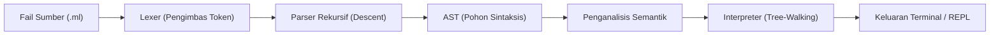

<div align="center">

  <a href="https://github.com/rillardian655/Melayu-Language-by-runa">
    
  </a>

  <br/><br/>

  <a href="https://github.com/rillardian655/Melayu-Language-by-runa">
    
  </a>

  <p align="center">
    <b>Bahasa pengaturcaraan serumpun bertaraf pengeluaran untuk pembangun Nusantara.</b><br/>
    <i>Direka untuk Indonesia, Malaysia, Brunei, dan Singapura. Dibina dari sifar menggunakan Rust.</i>
  </p>

  <p align="center">
    <a href="https://github.com/rillardian655/Melayu-Language-by-runa/releases">
      
    </a>
    <a href="https://github.com/rillardian655/Melayu-Language-by-runa">
      
    </a>
    <a href="editors/vscode">
      
    </a>
    <a href="https://www.rust-lang.org/">
      
    </a>
    <a href="LICENSE">
      
    </a>
    <a href="https://github.com/rillardian655/Melayu-Language-by-runa">
      
    </a>
    <a href="https://github.com/rillardian655/Melayu-Language-by-runa">
      
    </a>
    <a href="CONTRIBUTING.md">
      
    </a>
  </p>

  <p align="center">
    <a href="#pengenalan"><b>[ Pengenalan ]</b></a> &bull;
    <a href="#falsafah-reka-bentuk"><b>[ Falsafah ]</b></a> &bull;
    <a href="#seni-bina-kompilasi"><b>[ Seni Bina ]</b></a> &bull;
    <a href="#pemasangan"><b>[ Pemasangan ]</b></a> &bull;
    <a href="#contoh-pengaturcaraan"><b>[ Contoh ]</b></a> &bull;
    <a href="#dokumentasi-penuh"><b>[ Dokumentasi ]</b></a> &bull;
    <a href="#pelan-hala-tuju"><b>[ Pelan Hala Tuju ]</b></a>
  </p>

</div>

---

## Pengenalan

**MELAYU** (`.ml`) adalah bahasa pengaturcaraan sumber terbuka bertaraf pengeluaran (*production-grade*) yang direka khas untuk pembangun berlatarbelakangkan rumpun bahasa Melayu.

Objektif utama projek ini adalah **menghapuskan halangan bahasa dalam pembelajaran algoritma**. 

Bahasa pengaturcaraan konvensional memaksa pemula mengharungi dua beban kognitif serentak:
1. **Beban Logik**: Pembolehubah, lelaran, skop, penutupan (*closures*), dan rekursi.
2. **Beban Leksikal Asing**: Perbendaharaan kata bahasa Inggeris (`while`, `function`, `return`, `throw`, `catch`) serta sintaks lambang rumit seperti `{}` dan `;`.

MELAYU mengasingkan kedua-dua beban ini. Logika kekal moden, berstruktur, dan jitu, manakala sintaksnya berasaskan pertuturan harian yang semula jadi.

```melayu
# Demonstrasi sintaks asas MELAYU
ada nama = "Budi"
ada umur = 17

jika umur lebih sama 17
    tunjuk "Selamat datang, " + nama
    tunjuk "Status: Dewasa"
jika tidak
    tunjuk "Sabar dulu ya, " + nama
selesai
```

---

## Falsafah Reka Bentuk

* **Gotong-Royong**: Sintaks mengutamakan keterbacaan bersama. Menghindari amalan penulisan kod yang sengaja dikelirukan (*clever code*).
* **Beradat**: Menghormati tatabahasa Melayu (SPOK, kata hubung, dan imbuhan logik).
* **Kesederhanaan Sintaks**: Tanpa keperluan tanda titik koma (`;`) atau kurungan kurawal (`{}`). Blok ditutup secara eksplisit dengan `selesai`.
* **Mesej Ralat Mendidik**: Ralat bukan sekadar kod henti, tetapi bertindak sebagai pembimbing yang menerangkan **punca masalah** dan **langkah pembetulan**.

---

## Perbandingan Ciri & Seni Bina

| Keupayaan | MELAYU v0.4.0 | Python | JavaScript | Go |
|---|:---:|:---:|:---:|:---:|
| Kata Kunci Bahasa Melayu Asli | Terbina-Dalam | Tiada | Tiada | Tiada |
| Penutup Blok Eksplisit | `selesai` | Indentasi Sahaja | `{}` | `{}` |
| Bebas Lambang Mengelirukan (`;`, `{}`) | Ya | Separa | Tidak | Tidak |
| Operator Saluran Paip (`|>`) | Ya (Asli) | Tiada (Ditolak) | Tiada (Peringkat 2) | Tiada |
| Runner Ujian Unit Terbina-Dalam | Ya (`melayu uji`) | Perlu `pytest` | Perlu `jest`/`vitest` | Ya (`go test`) |
| Padanan Corak Ekspresif (`padan`) | Ya (Ekspresi) | Ya (Pernyataan) | Separa (`switch`) | Separa (`switch`) |
| Null-Coalescing & Akses Selamat | `??` dan `?.` | Tiada (Ternary) | Ya | Tiada |
| Penanda Aras Kinerja CLI | Ya (`melayu tanda-aras`) | Perlu modul asing | Perlu pakej luar | Ya (`testing.B`) |
| Mesej Ralat Mendidik Dwibahasa | Ya | Tidak | Tidak | Tidak |
| Enjin Asas | Rust (Memori Selamat) | C (CPython) | C++ (V8) | Go Runtime |
| REPL Interaktif Multi-Baris | Ya | Ya | Ya | Terhad |

---

## Seni Bina Kompilasi

Enjin MELAYU dibina mengikut saluran paip bahasa pengaturcaraan klasik berasaskan Rust:



### Modul Teras Enjin:
* `lexer.rs`: Mengubah kod sumber menjadi aliran token leksikal; menyokong kata kunci gabungan (`jika tidak jika`, `sama dengan`, `lebih sama`, `kurang sama`, `baca nombor`).
* `parser.rs`: Menghasilkan Abstract Syntax Tree (AST) berstruktur dengan algoritma *Precedence Climbing*.
* `analyzer.rs`: Memeriksa skop pembolehubah, mencegah deklarasi bertindih, dan melindungi pemalar (`tetap`).
* `interpreter.rs`: Enjin pelaksanaan AST dengan sokongan penutupan leksikal (*closures*), rekursi, dan struktur data mutabel.
* `errors.rs`: Penjana diagnostik ralat mesra pengguna lengkap dengan baris kod sumber dan penunjuk lajur.

---

## Pemasangan

### Prasyarat
* Rust versi 1.75 atau lebih baharu ([Muat turun Rust](https://rustup.rs/))
* Git

### Binaan Melalui Kod Sumber

```bash
# Klon repositori
git clone https://github.com/rillardian655/Melayu-Language-by-runa.git
cd Melayu-Language-by-runa

# Binaan binari release
cargo build --release
```

Fail binari yang telah dikompilasi terletak di `target/release/melayu`.

### Pemasangan Global (PATH)

**Linux & macOS:**
```bash
sudo cp target/release/melayu /usr/local/bin/
```

**Windows:**
Salin `target\release\melayu.exe` ke direktori yang didaftarkan dalam pembolehubah persekitaran `PATH`.

---

## Penggunaan CLI

```bash
# Membuka REPL Interaktif
melayu

# Menjalankan fail sumber
melayu jalankan aturcara.ml
melayu aturcara.ml

# Memeriksa sintaks dan semantik tanpa menjalankan program
melayu semak aturcara.ml

# Menjalankan suite ujian unit terbina-dalam
melayu uji contoh/suite_ujian.ml

# Menjalankan penanda aras masa pelaksanaan (benchmark)
melayu tanda-aras contoh/kiraan_matriks.ml 10

# Memaparkan maklumat bantuan dan versi
melayu bantuan
melayu versi
```

---

## Contoh Pengaturcaraan

### 1. Algoritma FizzBuzz

```melayu
untuk i dari 1 hingga 20
    jika i modulo 15 sama dengan 0
        tunjuk "FizzBuzz"
    jika tidak jika i modulo 3 sama dengan 0
        tunjuk "Fizz"
    jika tidak jika i modulo 5 sama dengan 0
        tunjuk "Buzz"
    jika tidak
        tunjuk i
    selesai
selesai
```

### 2. Fungsi & Rekursi (Fibonacci)

```melayu
kerja fibonacci(n)
    jika n kurang sama 0
        pulang 0
    selesai
    jika n sama dengan 1
        pulang 1
    selesai
    pulang fibonacci(n tolak 1) tambah fibonacci(n tolak 2)
selesai

untuk k dari 0 hingga 9
    tunjuk "F(" + k + ") = " + fibonacci(k)
selesai
```

### 3. Pengendalian Koleksi & Ralat

```melayu
ada senaraiData = ["epal", "durian", "rambutan"]
senaraiData.tambah("mangga")

tunjuk "Jumlah elemen: " + panjang(senaraiData)

cuba
    ada hasil = 100 bahagi 0
tangkap ralat
    tunjuk "Perhatian: " + ralat
akhirnya
    tunjuk "Pembersihan blok selesai."
selesai
```

### 4. Sistem Modul & Utiliti Koleksi Lanjutan (v0.1.2)

```melayu
# Import fungsi terpilih daripada modul luar
ambil kiraDiskaun daripada "examples/matematik_modul.ml"

# Pecahkan teks menjadi senarai, isih dan cantumkan semula
ada teksBuah = "mangga,durian,rambutan"
ada senaraiBuah = teksBuah.pecah(",")
senaraiBuah.isih()

tunjuk "Senarai buah tersusun: " + senaraiBuah.cantum(" -> ")
tunjuk "Harga promosi: RM" + kiraDiskaun(100, 20)
```

### 5. Pemprosesan Data Fungsian, Enjin JSON & Masa (v0.2.0)

```melayu
# Menghurai teks JSON piawai
ada dataPesanan = bacaJSON("{\"produk\": \"Kopi Luwak\", \"harga\": [25, 30, 45]}")

# Operasi fungsian senarai (tapis & petakan)
kerja mahal(harga)
    pulang harga lebih sama 30
selesai

ada hargaPremium = dataPesanan["harga"].tapis(mahal)
tunjuk "Harga premium: " + hargaPremium.cantum(", ")

# Tarikh dan masa kalendar sistem
tunjuk "Invois dikeluarkan pada: " + tarikhKini() + " " + masaKini()
```

### 6. Pengaturcaraan Berorientasikan Objek (OOP) (v0.3.0)

```melayu
# Pengisytiharan kelas asas
kelas Kenderaan
    bina(jenama, kelajuan_maks)
        diri.jenama = jenama
        diri.kelajuan_maks = kelajuan_maks
        diri.kelajuan_semasa = 0
    selesai

    kerja pandu(tambah_laju)
        diri.kelajuan_semasa = diri.kelajuan_semasa + tambah_laju
        pulang diri.kelajuan_semasa
    selesai
selesai

# Pewarisan kelas anak dengan kata kunci 'warisi' dan 'induk'
kelas KeretaElektrik warisi Kenderaan
    bina(jenama, kelajuan_maks, bateri)
        induk.bina(jenama, kelajuan_maks)
        diri.bateri = bateri
    selesai

    kerja cas(jumlah)
        diri.bateri = diri.bateri + jumlah
        pulang diri.bateri
    selesai
selesai

ada myviEV = KeretaElektrik("Perodua EV", 160, 90)
myviEV.pandu(80)
myviEV.pemilik = "Runa"

tunjuk "Jenis Objek:", jenis(myviEV)
tunjuk "Status bateri:", myviEV.bateri + "%"
tunjuk "Serialisasi JSON:", tulisJSON(myviEV, betul)
```

### 7. Keupayaan Moden Baharu (v0.4.0)

#### Saluran Paip (Pipeline Operator: `|>`)
```melayu
kerja darabDua(n)
    pulang n * 2
selesai

kerja tolakNilai(n, x)
    pulang n - x
selesai

# Pemprosesan data dari kiri ke kanan yang kemas dan berurutan
ada nilai = 10 |> darabDua |> tolakNilai(5)
# Hasil: (10 * 2) - 5 = 15
```

#### Padanan Corak Ekspresif (`padan`)
```melayu
kerja tentukanGred(skor)
    pulang padan skor
        bila 90 hingga 100 => "A+ Cemerlang"
        bila 80 hingga 89  => "A Kepujian"
        bila 50 hingga 79  => "Lulus"
        bila s jika skor < 0 => "Skor Tidak Sah (" + s + ")"
        lain => "Gagal"
    selesai
selesai
```

#### Null-Coalescing & Akses Rantai Selamat (`??` dan `?.`)
```melayu
ada profil = kosong
ada namaPengguna = profil?.nama ?? "Tetamu Anonim"
ada infoSapaan = profil?.sapa() ?? "Tiada profil"
```

#### Suite Ujian Unit Terbina-Dalam (`melayu uji`)
```melayu
uji "Kiraan diskaun dan harga akhir"
    ada harga = 100
    ada diskaun = 20
    ada hargaAkhir = harga - (harga * diskaun / 100)
    semak hargaAkhir == 80, "Harga akhir sepatutnya RM 80"
selesai
```

#### AkalML: Kerangka Kerja Pembelajaran Mesin Native (`ambil "akal"`)

Bahasa Melayu menyertakan kerangka kerja Machine Learning native serumpun bernama **AkalML**. Dikuasakan oleh enjin matriks dan aljabar linear berprestasi tinggi dalam Rust, AkalML membolehkan analisis data, ramalan numerik, dan pengelasan pintar tanpa kebergantungan luar.

* **Aljabar Linear, Tensor Native & Kalkulus**:
  * **Primitif `tensor` & Operator `@`**: `tensor([[1, 2], [3, 4]])`, `sifarTensor([2, 3])`, `satuTensor([2, 3])`, `rawakTensor([2, 3])`, pendaraban matriks `A @ B`, *broadcasting* `+`, `-`, `*`, `/`, serta kaedah `.bentuk()`, `.transposisi()`, `.jumlah()`, `.purata()`, `.sigmoid()`, `.relu()`, `.ubahBentuk()`, dan `.keSenarai()`.
  * Operasi matriks & pengaktifan: `darabMatriks`, `transposisiMatriks`, `songsangMatriks` (Gauss-Jordan), `jarakEuclidean`, `titikDarab`, `matriksTambah`, `matriksTolak`, `matriksSkala`, `darabHadamard`, `matriksJumlahLajur`, `matriksSigmoid`, `matriksDerivatifSigmoid`, `matriksReLU`, `matriksSoftmax`, `ralatEntropiSilang`, `eksponen`, dan `logaritmaAsli`.
* **Model Sedia Guna Asas & Pertengahan**: `RegresiLinear` (Ordinary Least Squares), `PengelasKNN` (K-Nearest Neighbors), `PengelompokanKMeans` (Unsupervised Clustering), dan `PokokKeputusan` (Decision Tree Classifier berasaskan Ketulenan Gini).
* **Model Tingkat Menengah-Tinggi (Mid-High) & Ensemble**:
  * **`HutanRawak` (Random Forest Classifier)**: Pengelas ensemble berasaskan pensampelan *bootstrap* (bagging) dan undian majoriti berbilang pokok keputusan untuk ketepatan tinggi pada data jadual.
  * **`JaringanSaraf`** & **`RangkaianAdam`**: Rangkaian saraf tiruan berlapis dengan sokongan `Tensor` native (`@`), pengaktifan **ReLU**, **Softmax**, **Cross-Entropy**, serta pengoptimum **Adam** (`RangkaianAdam`) untuk latihan berbilang kelas yang pantas dan stabil.
  * **Pecutan Perkakasan & Kebolehulangan**: `infoPerkakas()`, `benihRawak(n)` untuk eksperimen boleh diulang, serta pilihan GPU `MELAYU_GPU=fp32` (AMD ROCm / NVIDIA CUDA).
  * **`PengelasBayesNaif` (Gaussian Naive Bayes)**: Pengelas kebarangkalian berbilang ciri berasaskan taburan normal Gaussian.
* **Pemprosesan Bahasa Tabii (NLP)**: `PengiraTFIDF` (pengektrakan vektor teks) dan `kesamaanCosine(v1, v2)`.
* **Prapemprosesan, DataFrame & Metrik Penilaian Lengkap**:
  * **Pengolahan Data Tabular (`JadualData` / DataFrame ala Pandas)**: `bacaJadual(laluan)`, `.pilihLajur()`, `.tapis()`, `.isiKosong()` (imputasi nilai hilang), `.ringkasan()`, dan `.keMatriks()`.
  * **Pengkodan Kategori**: `PengkodLabel` (LabelEncoder dengan `.songsang()`) dan `PengkodSatuPanas` (OneHotEncoder).
  * **Penyekalaan Ciri**: `SkalaMinMaks` (MinMaxScaler) dan `PenyelarasanPiawai` (StandardScaler) dengan kaedah `latih()`, `transformasi()`, `latihTransformasi()`, dan `songsang()`.
  * **Dataset Terbina-Dalam**: `muatIris()` (Dataset Bunga Fisher Iris), `muatKredit()` (Dataset Penilaian Kelayakan Kredit), dan `janaDataSintetik(sampel, ciri)` (Penjana data rawak terkawal).
  * **Validasi Silang & Pembahagian**: `pengesahanSilang(kilangModel, X, y, k)` (K-Fold Cross Validation), `bacaCSV`, dan `bahagiLatihUji`.
  * Metrik penilaian model: `matriksKekeliruan` (Confusion Matrix TP/FP/TN/FN), `kejituan` (Precision), `kepekaan` (Recall), `skorF1` (F1-Score), `skorR2`, `skorMSE`, dan `skorAkurasi`.
* **Penstoran Model ke Cakera (Model Persistence)**:
  * Simpan struktur dan parameter model terus ke format JSON: `model.simpan("laluan/model.json")`.
  * Muat semula model bila-bila masa untuk inferens masa nyata tanpa latihan semula: `model.muat("laluan/model.json")`. Tersedia untuk `JaringanSaraf`, `HutanRawak`, `RegresiLinear`, `PengelasBayesNaif`, dan `PokokKeputusan`.

Contoh Jaringan Saraf Tiruan (Deep Learning):
```melayu
ambil "akal"

# Masalah XOR (Tak-linear)
ada X = [[0.0, 0.0], [0.0, 1.0], [1.0, 0.0], [1.0, 1.0]]
ada y = [[0.0], [1.0], [1.0], [0.0]]

# Penyekalaan Ciri Min-Max
ada penyekala = SkalaMinMaks()
ada X_skala = penyekala.latihTransformasi(X)

# Bina model [2 masukan -> 4 neuron tersembunyi -> 1 keluaran]
ada nn = JaringanSaraf([2, 4, 1], 3.4)
nn.latih(X_skala, y, 2000, betul)

# Simpan dan muat semula model
nn.simpan("model_xor.json")
ada model_muat = JaringanSaraf([2, 4, 1], 3.4)
model_muat.muat("model_xor.json")

ada ramalan = model_muat.ramal(X_skala)
tunjuk "Akurasi XOR:", model_muat.skor(X_skala, [0, 1, 1, 0]) * 100, "%"
```

Contoh Regresi Linear:
```melayu
ambil "akal"

# Data ciri: [Keluasan (m2), Bilangan Bilik]
ada X = [[50.0, 1.0], [70.0, 2.0], [120.0, 3.0], [180.0, 4.0]]
# Sasaran: Harga (ribu)
ada y = [150.0, 205.0, 340.0, 500.0]

ada model = RegresiLinear(betul)
model.latih(X, y)

# Ramalkan harga rumah baharu 100m2, 2 bilik
ada ramalan = model.ramal([[100.0, 2.0]])
tunjuk "Ramalan Harga:", bundar(ramalan[0]), "k"
tunjuk "Ketepatan R2  :", model.skor(X, y)
```

#### Selasih: Kerangka Kerja Web Server & REST API (`ambil "selasih"`)

Bahasa Melayu kini dilengkapi kerangka kerja pelayan HTTP native bernama **Selasih**. Dibina di atas enjin rangkaian standard tanpa sebarang pustaka pihak ketiga, Selasih membolehkan pembangunan mikroservis web dan REST API berprestasi tinggi secara terus dalam Bahasa Melayu.

* **Penghalaan (Routing) Lengkap**: `aplikasi.dapatkan(laluan, handler)`, `aplikasi.hantar(laluan, handler)`, `aplikasi.kemaskini(laluan, handler)`, `aplikasi.padam(laluan, handler)`.
* **Sistem Pengantara (Middlewares)**: `aplikasi.guna(pengantaraFn)` untuk pintasan logik global seperti pengesahan token (auth), pembalakan konsol (`pengantaraLogger`), atau sekatan kadar.
* **Sokongan CORS Automatik**: Pengendalian permintaan pra-penerbangan `OPTIONS` secara native dengan fungsi pembantu `balasCORS(status)`.
* **Fungsi Pembantu Respons Terbina**: `balasJSON(data, status)`, `balasHTML(kandungan, status)`, dan `balasTeks(mesej, status)`.
* **Objek Permintaan Pintar**: Penguraian kaedah HTTP (`req.kaedah`), laluan URL (`req.laluan`), kepala permintaan (`req.kepala`), teks badan (`req.badan`), dan penukar JSON segera (`req.json()`).
* **Klien HTTP & HTTPS Standard**: Fungsi `hantarPermintaanHTTP(kaedah, url, kepala, badan)` dengan sokongan TLS (`https://` melalui `rustls`) dan anti-SSRF.

#### Pangkalan: Pangkalan Data Terbenam (`ambil "pangkalan"`)

Menyediakan storan jadual dan dokumen JSON berstruktur yang patuh sepenuhnya kepada sandbox keselamatan Bahasa Melayu:
* `Pangkalan(laluan_fail)`: `.ciptaJadual()`, `.sisip()`, `.cari()`, `.cariSatu()`, `.cariSemua()`, `.kemaskini()`, `.padam()`, dan `.bilang()`.

Panduan modul terperinci, buku panduan rasmi, dan demo full-stack tersedia di:
* [Buku Panduan Resmi (Bahasa Indonesia)](docs/MANUAL_BOOK_ID.md)
* [Official Manual Book (English)](docs/MANUAL_BOOK_EN.md)
* [Panduan AkalML](docs/akalml.md)
* [Panduan Selasih Web](docs/selasih.md)
* [Panduan Pangkalan Data](docs/pangkalan.md)
* [Demo Papan Pemuka AI (Selasih + HTML/CSS/JS + Pangkalan)](examples/papan_pemuka_ai.ml)
* [Taman Permainan Web](playground/index.html)

#### Pengurus Pakej & Utiliti CLI (`melayu mula`, `format`, `taman`)

* **`melayu format <fail.ml> [--semak]`**: Merapikan indentasi (4 ruang) dan susunan kod Bahasa Melayu secara automatik.
* **`melayu taman [port]`**: Membuka taman permainan web interaktif di pelayar tempatan.
* **`--had-langkah <n>` / `MELAYU_HAD_LANGKAH`**: Mengawal atau mematikan (`0`) had langkah untuk latihan dataset ML bersaiz besar.

Contoh Pelayan Web Selasih:
```melayu
ambil "selasih"

kerja kendaliLamanUtama(permintaan)
    pulang balasHTML("<h1>Selamat Datang ke Selasih Web Server</h1>", 200)
selesai

kerja kendaliAPIStatus(permintaan)
    ada info = {
        "status": "aktif",
        "pelayan": "Selasih v1.0",
        "bahasa": "Melayu"
    }
    pulang balasJSON(info, 200)
selesai

ada app = PelayanWeb(8080)
app.dapatkan("/", kendaliLamanUtama)
app.dapatkan("/api/status", kendaliAPIStatus)

tunjuk "Pelayan Selasih beroperasi pada http://localhost:8080"
app.dengar(0)
```

#### Pengurus Pakej CLI Melayu (`melayu mula`, `pasang`, `pakej`)

Bahasa Melayu menyertakan pengurus projek dan pakej rasmi untuk mempermudah organisasi kod modular:

* **Inisialisasi Projek Baharu (`melayu mula <nama_projek> [--mvc]`)**:
  * Mod Asas: Menjana struktur ringkas dengan `pakej.json`, `utama.ml`, folder modul `modul_melayu/`, dan `.gitignore`.
  * Mod MVC (`--mvc`): Menjana seni bina perusahaan lengkap (ala Laravel/Clean Architecture) dengan `app/kawalan/` (Controller), `app/model/` (Model), `app/perkhidmatan/` (Service), `laluan/` (Router), `data/`, dan `konfigurasi.json`.
* **Pemasangan & Pengurusan Pakej (`melayu pasang <modul>`)**:
  Memasang fail pakej `.ml` terus ke dalam direktori `modul_melayu/` dan mendaftarkannya ke dalam `pakej.json`.
* **Senarai Pakej (`melayu pakej`)**:
  Memaparkan senarai kerangka kerja standard yang disertakan (`akal`, `selasih`) serta pakej luaran yang terpasang.
* **Resolusi Modul Automatik**:
  Pernyataan `ambil "nama_modul"` secara pintar mencari modul pada direktori semasa atau di dalam folder `modul_melayu/nama_modul.ml`.

---

## Ekstensi Rasmi Visual Studio Code

Pembangun boleh menikmati pengalaman pengaturcaraan yang selesa menggunakan ekstensi rasmi VS Code yang disediakan dalam folder [`editors/vscode/`](editors/vscode/):

* **Pewarnaan Sintaks Penuh**: Syntax highlighting untuk kata kunci Melayu, pembolehubah, jenis data, rentetan, dan pengendali ralat.
* **Snippets Pintar**: Menaip pantas untuk blok `kerja`, `jika`, `selagi`, `untuk`, `cuba...tangkap`, dan `ambil`.
* **Konfigurasi Bahasa**: Autolengkap tanda kurung, lipatan kod (*code folding*), dan aturan indentasi automatik.

Sila rujuk panduan pemasangan lengkap di [editors/vscode/README.md](editors/vscode/README.md).

---

## Sistem Mesej Ralat Berhemah

MELAYU mengutamakan kejelasan mesej ralat untuk membantu proses nyahpepijat (*debugging*):

```text
Eh! Ada ralat di baris 1, lajur 1:
  tunjukkan "Selamat Pagi"
  ^
  "tunjukkan" tu bukan keyword Melayu yang sah.
  -> Mungkin maksud kau "tunjuk"? Cuba betulkan dulu.
```

```text
Alamak! Ada ralat di baris 4, lajur 1:
  ada umur = 20
  ^
  Pembolehubah 'umur' dah wujud, tak boleh dideklarasikan dua kali.
  -> Guna nama lain, atau buang 'ada' kalau kau cuma nak tukar nilai 'umur = ...'.
```

```text
Aduh! Ada ralat di baris 1, lajur 16:
  ada hasil = 10 bahagi 0
                 ^
  Pembahagian dengan kosong tak boleh lah bro.
  -> Cuba semak pembahagi kau, pastikan nilainya bukan 0.
```

---

## Ciri Keselamatan & Pengukuhan Sandbox (Security Hardened)

Bermula dari versi v0.1.1, enjin MELAYU dilengkapi ciri perlindungan keselamatan aras sistem hos:

1. **Perlindungan 'Stack Overflow' (CWE-674)**: Had rekursi fungsi ditetapkan maksimum 1,000 tahap secara lalai bagi menghalang keruntuhan proses hos (*native stack overflow*).
2. **Pencegahan 'Runaway Loop' / DoS (CWE-400)**: Had pelaksanaan 10,000,000 langkah secara automatik menamatkan gelung tak terhingga (*infinite loop*) secara selamat.
3. **Pengesahan Indeks Ketat**:
   - Menolak indeks `NaN`, `Infiniti`, atau nombor pecahan/perpuluhan (`senarai[1.5]`).
   - Menyokong indeks negatif yang sah (contoh: `senarai[-1]` untuk elemen terakhir).
4. **Perlindungan 'Path Traversal' Sandbox**:
   - Fungsi operasi fail (`bacaFail`, `tulisFail`, `wujudFail`, `padamFail`) disaring ketat.
   - Percubaan mengakses laluan luar seperti `../` atau direktori sistem disekat sepenuhnya.
5. **Had Memori & Saiz Fail**:
   - Bacaan dan penulisan fail dihadkan kepada saiz maksimum 5 MB.
   - Cantuman teks dihadkan kepada 16 MB dan cantuman senarai kepada 1,000,000 elemen untuk mengelakkan keletihan memori (*OOM bomb*).
6. **Penjana Nombor Rawak Berentropi Tinggi**:
   - Menyertakan `rawak()` dan `rawak(min, max)` berasaskan algoritma SplitMix64 tanpa sebarang kebergantungan luar.

---

## Dokumentasi Rasmi

Maklumat terperinci disediakan dalam folder [`docs/`](docs/):

* [Pengenalan & Visi](docs/pengenalan.md) — Konteks penubuhan bahasa dan latar belakang.
* [Spesifikasi Sintaks](docs/sintaks.md) — Rujukan tatabahasa formal dan binaan bahasa.
* [Jadual Kata Kunci](docs/keyword.md) — Pemetaan kosa kata Melayu dan padanan antarabangsa.
* [Seni Bina Dalaman Enjin](docs/seni_bina.md) — Saluran paip kompilasi, AST, dan model memori.
* [Panduan Gaya Kod](docs/panduan_gaya_kod.md) — Konvensyen penamaan rasmi dan amalan terbaik.
* [Glosari Istilah Sains Komputer](docs/glosari_istilah.md) — Rujukan istilah pengaturcaraan serumpun.
* [Katalog Mesej Ralat & Nyahpepijat](docs/senarai_ralat.md) — Panduan pembetulan ralat mendidik.
* [Soalan Lazim (FAQ)](docs/faq.md) — Jawapan kepada pertanyaan lazim komuniti.
* [Spesifikasi Pelan v1.0.0 (Bytecode VM & WASM)](docs/pelan_hala_tuju_v1.md) — Hala tuju enjin berprestasi tinggi.
* [Koleksi Contoh Program](examples/readme.md) — Direktori atur cara contoh sedia guna.
* [Pelan Pembangunan](docs/roadmap.md) — Sasaran versi v0.2.0 hingga v1.0.0.

---

## Pelan Hala Tuju (Roadmap)

### [x] v0.1.0 — MVP
* Pembolehubah mutabel (`ada`) dan pemalar (`tetap`).
* Jenis data primitif (`teks`, `nombor`, `betul`, `salah`, `kosong`).
* Kawalan aliran (`jika`, `jika tidak jika`, `jika tidak`, `selesai`).
* Gelung lelaran (`selagi`, `untuk ... dalam`, `untuk ... dari ... hingga`).
* Pengisytiharan fungsi (`kerja`) berserta nilai pulangan (`pulang`).
* Struktur data koleksi (`senarai`, `kamus`).
* Pengendalian ralat runtime (`cuba`, `tangkap`, `baling`, `akhirnya`).
* Utiliti CLI dan konsol REPL interaktif.

### [x] v0.1.1 — Keselamatan & Sandbox
* Perlindungan limpahan tindanan (*stack overflow protection*) had rekursi 1,000.
* Perlindungan DoS gelung tak terhingga (*infinite loop execution step limit*).
* Pengesahan indeks ketat (penolakan NaN, infiniti, pecahan, pencegahan underflow).
* Sandbox operasi fail (`bacaFail`, `tulisFail`, `wujudFail`, `padamFail`) dengan perlindungan *path traversal*.
* Had saiz fail (5 MB) dan had saiz memori (16 MB teks, 1M elemen senarai).
* Fungsi nombor rawak berentropi tinggi `rawak(min, max)`.
* Suite ujian keselamatan khas (`tests/security_test.rs`).

### [x] v0.1.2 — Modul, Utiliti Koleksi & Ekstensi VS Code
* Sistem import fail modular: `ambil "fail.ml"`, `ambil "fail.ml" sebagai alias`, dan `ambil fungsi daripada "fail.ml"`.
* Kaedah manipulasi teks lanjutan: `.pecah()`, `.ganti()`, `.mulaDengan()`, `.tamatDengan()`, `.mengandungi()`.
* Kaedah pengurusan senarai: `.isih()`, `.balik()`, `.cantum()`.
* Fungsi utiliti matematik: `bundar()`, `lantai()`, `siling()`, `mutlak()`, `maksimum()`, `minimum()`.
* Ekstensi rasmi Visual Studio Code (`editors/vscode/`) dengan pewarnaan sintaks dan snippets.

### [x] v0.2.0 — Pemprosesan Data Fungsian, Enjin JSON & Masa
* Operasi fungsian senarai: `.petakan()`, `.tapis()`, `.kiraSemua()`, `.cari()`, `.indeks()`, `.setiapSatu()`.
* Enjin JSON selamat tanpa kebergantungan luar: `bacaJSON()` dan `tulisJSON()`.
* Utiliti kalendar & masa berketepatan tinggi: `capMasa()`, `masaKini()`, `tarikhKini()`.
* Kaedah manipulasi rentetan & kamus baharu: `.ulang()`, `.selitDepan()`, `.selitBelakang()`, `.hurufAwalBesar()`, `.adaKunci()`, `.buang()`.
* Pengukuhan ujian dengan 28 suite ujian komprehensif.

### [x] v0.3.0 — Pengaturcaraan Berorientasikan Objek
* Definisi kelas berstruktur: `kelas <Nama> ... selesai`.
* Pembina objek dan pemulaan sifat: `bina(<parameter>) ... selesai`.
* Rujukan instans objek: `diri` (`this`/`self`) bagi pengumpukan dan pembacaan sifat.
* Pewarisan kelas: `kelas Anak warisi Induk`.
* Rujukan kaedah dan pembina induk: `induk.bina(...)` dan `induk.kaedah(...)`.
* Pengumpukan sifat dinamik: `obj.sifat = nilai` dan `obj["sifat"] = nilai`.
* Integrasi fungsi terbina-dalam: `jenis(obj)` mengembalikan nama kelas, `tulisJSON(obj)` serialisasi data instans.
* Pengoptimuman memori aras enjin mengurangkan saiz stack frame sebanyak > 60% bebas *stack overflow*.
* Sokongan ekstensi VS Code: tatabahasa TextMate dan koleksi snippets pintar OOP.

### [x] v0.4.1 — Ekosistem Lanjutan AkalML, Selasih & MVC (Rilis Semasa)
* **AkalML v1.0**: Enjin Machine Learning native (Regresi Linear, KNN, K-Means, Jaringan Saraf Deep Learning MLP, Gaussian Naive Bayes, dan Pokok Keputusan Gini).
* **Dataset Terbina & Prapemprosesan**: `muatIris()`, `muatKredit()`, `janaDataSintetik()`, `SkalaMinMaks`, dan `PenyelarasanPiawai`.
* **Penstoran Model ke Cakera**: Kaedah `.simpan()` dan `.muat()` berformat JSON bagi semua model.
* **Kerangka Kerja Web Selasih**: Pelayan HTTP TCP native, penghalaan REST API, middleware (`.guna()`), dan sokongan CORS.
* **Pengurus Pakej CLI**: Perintah `melayu mula`, `melayu mula --mvc` (penjana struktur MVC penuh ala Laravel), `melayu pasang`, dan `melayu pakej`.

### [ ] v1.0.0 — Kestabilan Penuh & Web WASM
* Enjin Virtual Machine (VM) bytecode berprestasi tinggi.
* Pengurus pakej rasmi Melayu.
* Taman permainan web interaktif berasaskan WebAssembly (WASM).

---

## Panduan Sumbangan

Penyertaan daripada komuniti pembangunan sumber terbuka amat dihargai. Sila rujuk [CONTRIBUTING.md](CONTRIBUTING.md) untuk panduan aliran kerja Git, standard pemformatan kod (`cargo fmt`), dan pengesahan kualiti (`cargo clippy`).

---

## Lesen Projek

Projek ini diedarkan di bawah syarat-syarat [Lesen MIT](LICENSE). Hak Cipta (c) 2026 xianly runa.

<div align="center">
  <sub>Dibina dengan integriti untuk memperkasa komuniti teknologi serumpun.</sub>
</div>
