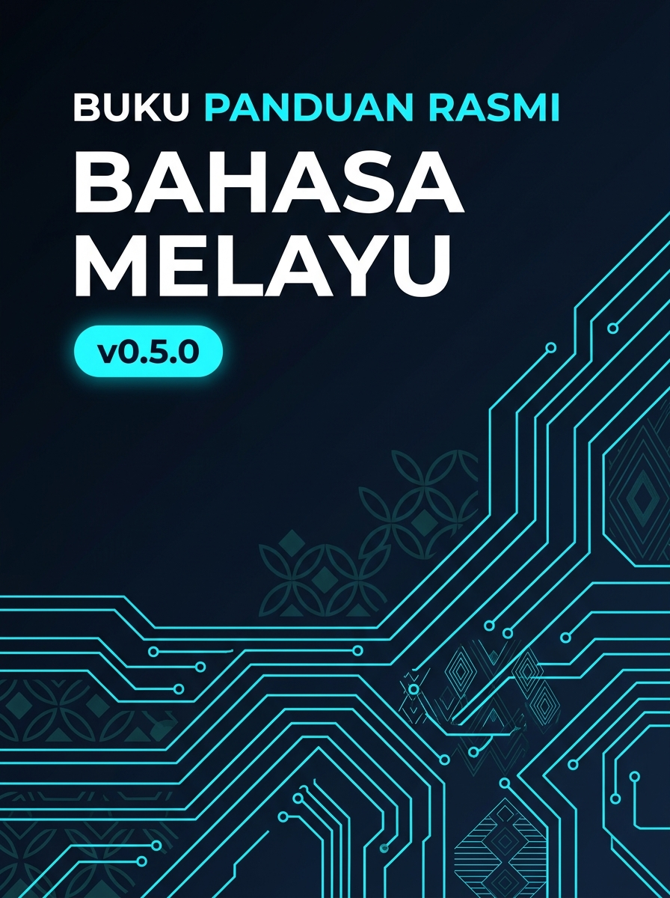
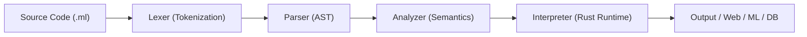

<div align="center">



<br/><br/>


# OFFICIAL MANUAL BOOK: MELAYU PROGRAMMING LANGUAGE

**Complete Edition v0.5.0 — From Zero to Full-Stack Web, Database, & Machine Learning**

*Designed for developers across Indonesia, Malaysia, Brunei, and Singapore.*  
*Built with Rust | MIT License*

[Baca dalam Bahasa Indonesia (Indonesian Version)](MANUAL_BOOK_ID.md) &bull; [Back to README](../README.md)

</div>

---

## Book Front Page & Table of Contents

Welcome to the **Official Manual Book for the MELAYU Programming Language (`.ml`)**. This handbook is written so that anyone—from beginners learning programming logic for the first time to experienced engineers—can understand how MELAYU works from scratch all the way to building full-stack web services and Machine Learning pipelines.

### Table of Contents

- [Chapter 1: Introduction & Engine Architecture](#chapter-1-introduction--engine-architecture)
- [Chapter 2: Installation, CLI, & Web Playground](#chapter-2-installation-cli--web-playground)
- [Chapter 3: Language Basics (Variables, Data Types, Operators, I/O)](#chapter-3-language-basics-variables-data-types-operators-io)
- [Chapter 4: Control Flow & Loops](#chapter-4-control-flow--loops)
- [Chapter 5: Functions, Pipelines, Null-Safety, & Error Handling](#chapter-5-functions-pipelines-null-safety--error-handling)
- [Chapter 6: Collections (`senarai` & `kamus`) and Built-in Methods](#chapter-6-collections-senarai--kamus-and-built-in-methods)
- [Chapter 7: Object-Oriented Programming (OOP)](#chapter-7-object-oriented-programming-oop)
- [Chapter 8: Module System, Testing (`uji`), & Project Management](#chapter-8-module-system-testing-uji--project-management)
- [Chapter 9: AkalML & Native Tensors (Machine Learning & Deep Learning)](#chapter-9-akalml--native-tensors-machine-learning--deep-learning)
- [Chapter 10: Selasih Web Framework & HTTP/HTTPS Client](#chapter-10-selasih-web-framework--httphttps-client)
- [Chapter 11: Pangkalan Embedded JSON Database](#chapter-11-pangkalan-embedded-json-database)
- [Chapter 12: Security, Sandboxing, & Engine Limits](#chapter-12-security-sandboxing--engine-limits)
- [Appendix: Quick Reference](#appendix-quick-reference)

---

## Chapter 1: Introduction & Engine Architecture

**Why MELAYU?**  
Many learners struggle with programming not because algorithms are hard, but because they have to translate English keywords while learning new concepts. **MELAYU** removes that barrier with natural Nusantara keywords (`ada`, `jika`, `selagi`, `kerja`, `pulang`, `selesai`) powered by a fast, memory-safe Rust interpreter.

Beyond education, MELAYU `v0.5.0` ships with three built-in standard-library frameworks inside `std/`:
1. **`akal`** (`AkalML`): Machine Learning, Deep Learning, TF-IDF NLP, and native `Tensor` math.
2. **`selasih`**: HTTP web server, REST API router, middleware, CORS, and HTTP/HTTPS client.
3. **`pangkalan`**: Embedded JSON document/table database that strictly respects the project sandbox.

### Engine Execution Pipeline



---

## Chapter 2: Installation, CLI, & Web Playground

### 2.1 Building from Source

Ensure Rust (minimum `1.75`) is installed on your machine:

```bash
git clone https://github.com/rillardian655/Melayu-Language-by-runa.git
cd Melayu-Language-by-runa
cargo build --release
```

The compiled binary is placed at `target/release/melayu`. To build without TLS/HTTPS dependencies, run:

```bash
cargo build --release --no-default-features
```

### 2.2 Core CLI Commands

| Command | Purpose | Example |
| :--- | :--- | :--- |
| `melayu` | Launch the interactive REPL | `melayu` |
| `melayu <file.ml>` | Run a `.ml` script | `melayu examples/fizzbuzz.ml` |
| `melayu jalankan <file.ml>` | Explicit alias to run a script (`run`) | `melayu jalankan app.ml` |
| `melayu semak <file.ml>` | Syntax & semantic check without executing (`check`) | `melayu semak app.ml` |
| `melayu format <file.ml>` | Format code with 4-space indentation (`fmt`) | `melayu format app.ml` |
| `melayu format <file.ml> --semak` | Verify formatting without modifying the file | `melayu format app.ml --semak` |
| `melayu uji <file.ml>` | Run `uji ... semak` test blocks (`test`) | `melayu uji suite.ml` |
| `melayu tanda-aras <file.ml> [n]` | Benchmark script execution (`n` iterations) | `melayu tanda-aras app.ml 10` |
| `melayu mula [name] [--mvc]` | Initialize a project (`pakej.json` / MVC template) | `melayu mula myapp --mvc` |
| `melayu taman [port]` | Start the local Web Playground (default `7878`) | `melayu taman 7878` |
| `melayu bantuan` | Print CLI help (`--help`) | `melayu bantuan` |

### 2.3 Sample CLI Output

```text
$ melayu examples/papan_pemuka_ai.ml
==========================================================
   PAPAN PEMUKA AI FULL-STACK: SELASIH + HTML/CSS/JS
==========================================================
[1/3] Model RangkaianAdam sedia (Akurasi: 99%)
[2/3] Ujian inferens & simpan DB: Virginica (Jumlah rekod: 1)
[3/3] Papan pemuka web siap dihidupkan melalui app.dengar() pada port 8095.
```

---

## Chapter 3: Language Basics (Variables, Data Types, Operators, I/O)

### 3.1 Variables (`ada`) and Constants (`tetap`)

Use `ada` for mutable variables and `tetap` for immutable constants. Type annotations are optional.

```melayu
ada name = "Raka"
ada age = 20
tetap PI = 3.14159

# Optional type annotations
ada height: nombor = 172.5
ada city: teks = "Jakarta"
ada active: betul = betul
```

### 3.2 Built-in Data Types

| Type | Example Values | Description |
| :--- | :--- | :--- |
| `nombor` | `42`, `3.14`, `1e21`, `5.9e-05` | 64-bit floating-point number (`f64`) |
| `teks` | `"Hello World"` | UTF-8 string |
| `betul` / `salah` | `betul`, `salah` | Boolean (`true` / `false`) |
| `kosong` | `kosong` | Null / empty value |
| `senarai` | `[10, 20, 30]` | Indexed list (supports negative indexing `s[-1]`) |
| `kamus` | `{"name": "Siti", "age": 22}` | Insertion-ordered key-value dictionary |
| `Tensor` | `tensor([[1, 2], [3, 4]])` | N-dimensional numeric array for vectorized/matrix math |

### 3.3 Word Operators vs Symbols

MELAYU supports both natural Malay words and standard symbols interchangeably:

- **Arithmetic**: `tambah` (`+`), `tolak` (`-`), `kali` (`*`), `bahagi` (`/`), `modulo` (`%`), `@` (matrix/tensor multiplication).
- **Comparison**: `sama dengan` (`==`), `tidak sama` (`!=`), `lebih` (`>`), `kurang` (`<`), `lebih sama` (`>=`), `kurang sama` (`<=`).
- **Logical**: `dan` (`&&`), `atau` (`||`), `bukan` (`!`).

### 3.4 Terminal Input & Output

```melayu
tunjuk "What is your name?"
ada name = baca()
tunjuk "How old are you?"
ada age = baca nombor()

tunjuk "Hello " + name + ", you are " + teks(age) + " years old."
```

---

## Chapter 4: Control Flow & Loops

Every block in MELAYU is closed explicitly with `selesai` (no curly braces `{}` for control blocks).

### 4.1 Conditionals (`jika`)

```melayu
ada score = 85

jika score lebih sama 90
    tunjuk "Grade A"
jika tidak jika score lebih sama 75
    tunjuk "Grade B"
jika tidak
    tunjuk "Keep practicing"
selesai
```

### 4.2 Pattern Matching (`padan ... bila ... lain`)

A clean alternative to long `jika tidak jika` chains:

```melayu
ada day = "Saturday"

padan day
    bila "Saturday" => tunjuk "Weekend!"
    bila "Sunday" => tunjuk "Rest day!"
    lain => tunjuk "Workday."
selesai
```

### 4.3 Loops (`selagi` and `untuk`)

```melayu
# 1. While loop
ada count = 1
selagi count kurang sama 3
    tunjuk "Count:", count
    count = count + 1
selesai

# 2. Range loop with optional step
untuk x dari 0 hingga 10 langkah 2
    jika x == 4
        teruskan
    selesai
    jika x == 8
        hentikan
    selesai
    tunjuk x
selesai

# 3. For-each loop
ada fruits = ["mango", "durian", "rambutan"]
untuk item dalam fruits
    tunjuk "Fruit:", item
selesai
```

---

## Chapter 5: Functions, Pipelines, Null-Safety, & Error Handling

### 5.1 Functions (`kerja` & `pulang`)

```melayu
kerja calcArea(width, height)
    pulang width * height
selesai

tunjuk "Area:", calcArea(5, 4)
```

### 5.2 Pipeline Operator (`|>` or `alir`)

Passes the result of an expression as the first argument to the next function:

```melayu
kerja addFive(n)
    pulang n + 5
selesai

kerja double(n)
    pulang n * 2
selesai

ada result = 10 |> addFive |> double
tunjuk result   # 30
```

### 5.3 Null-Safety (`??` and `?.`)

```melayu
ada profile = {"name": "Budi", "address": kosong}

# ?? provides a fallback when the left side is kosong
ada city = profile["address"] ?? "Not provided"
tunjuk city

# ?. safely accesses nested properties without crashing on kosong
ada cityName = profile["address"]?.city ?? "Unknown"
tunjuk cityName
```

### 5.4 Error Handling (`cuba ... tangkap ... akhirnya`)

```melayu
cuba
    ada val = 10 / 0
    tunjuk val
tangkap err
    tunjuk "Caught error:", err
akhirnya
    tunjuk "Cleanup block always runs."
selesai
```

You can also raise custom errors manually using `baling "Custom error message"`.

---

## Chapter 6: Collections (`senarai` & `kamus`) and Built-in Methods

### 6.1 Lists (`senarai`) & Functional Helpers

```melayu
ada nums = [5, 2, 8, 1, 4]
nums.tambah(10)
nums.isih()                  # [1, 2, 4, 5, 8, 10]

kerja isEven(x) pulang x % 2 == 0 selesai
kerja timesTwo(x) pulang x * 2 selesai

ada result = nums.tapis(isEven).petakan(timesTwo)
tunjuk result.cantum(" - ")  # "4 - 8 - 16 - 20"
```

Other `senarai` methods: `.buang(index)`, `.panjang()`, `.berisi(item)`, `.balik()`, `.kiraSemua(fn, init)`, `.cari(fn)`, `.indeks(item)`, `.setiapSatu(fn)`.

### 6.2 Dictionaries (`kamus`)

Dictionaries in MELAYU preserve insertion order:

```melayu
ada user = {"name": "Ayu", "role": "Admin"}
tunjuk user.adaKunci("name")  # betul
tunjuk user.kunci()           # ["name", "role"]
tunjuk user.nilai()           # ["Ayu", "Admin"]
user.buang("role")
```

### 6.3 String (`teks`) Methods

`teks` supports: `.pecah(sep)`, `.ganti(old, new)`, `.mulaDengan(prefix)`, `.tamatDengan(suffix)`, `.mengandungi(sub)`, `.hurufBesar()`, `.hurufKecil()`, `.panjang()`, `.potong()`, `.ulang(n)`, `.selitDepan(len, ch?)`, `.selitBelakang(len, ch?)`, `.hurufAwalBesar()`.

---

## Chapter 7: Object-Oriented Programming (OOP)

MELAYU supports native OOP with `kelas` (class), `bina` (constructor), `diri` (`this`/`self`), `warisi` (`extends`), and `induk` (`super`).

```melayu
kelas Vehicle
    bina(brand, year)
        diri.brand = brand
        diri.year = year
    selesai

    kerja info()
        pulang diri.brand + " (" + teks(diri.year) + ")"
    selesai
selesai

kelas ElectricCar warisi Vehicle
    bina(brand, year, battery)
        induk.bina(brand, year)
        diri.battery = battery
    selesai

    kerja info()
        pulang induk.info() + " - Battery " + teks(diri.battery) + "%"
    selesai
selesai

ada ev = ElectricCar("Proton e.MAS", 2026, 95)
tunjuk jenis(ev)   # "ElectricCar"
tunjuk ev.info()   # "Proton e.MAS (2026) - Battery 95%"
```

---

## Chapter 8: Module System, Testing (`uji`), & Project Management

### 8.1 Three Ways to Import Modules (`ambil`)

```melayu
# 1. Import all symbols into the current scope
ambil "helpers.ml"

# 2. Import into a namespace dictionary
ambil "math.ml" sebagai mat
tunjuk mat.addTwo(10)

# 3. Selective symbol import
ambil calcDiscount, checkStock daripada "shop.ml"
```

### 8.2 Built-in Unit Testing (`uji ... semak`)

Run test files using `melayu uji test_file.ml`:

```melayu
uji "basic addition"
    ada result = 2 + 3
    semak result == 5
selesai
```

### 8.3 Projects with `pakej.json`

Running `melayu mula my_project` creates `pakej.json`. The nearest directory containing `pakej.json` automatically defines the project's file sandbox root.

---

## Chapter 9: AkalML & Native Tensors (Machine Learning & Deep Learning)

### 9.1 `Tensor` Primitives & `@` Operator

`Tensor` supports native matrix multiplication `@`, bias broadcasting, and fast activations:

```melayu
ada X = tensor([[1.0, 2.0], [3.0, 4.0]])
ada W = rawakTensor([2, 2])
ada b = sifarTensor([2])

ada Z = ((X @ W) + b).relu()
tunjuk Z.bentuk()
tunjuk Z.purata()
```

`Tensor` methods: `.bentuk()`, `.jumlah()`, `.purata()`, `.transposisi()`, `.sigmoid()`, `.relu()`, `.ubahBentuk(new_shape)`.

### 9.2 Classes in `ambil "akal"`

| Category | Key Classes / Functions |
| :--- | :--- |
| **Regression & Classification** | `RegresiLinear`, `PengelasKNN`, `PengelasBayesNaif`, `PokokKeputusan`, `HutanRawak` |
| **Clustering** | `PengelompokanKMeans` |
| **Deep Learning** | `JaringanSaraf`, `LapisanLinear`, `RangkaianAdam` |
| **Data & Preprocessing** | `JadualData`, `SkalaMinMaks`, `PenyelarasanPiawai`, `PengkodLabel`, `PengkodSatuPanas` |
| **NLP & Validation** | `PengiraTFIDF`, `kesamaanCosine`, `bahagiLatihUji`, `pengesahanSilang`, `benihRawak` |
| **Built-in Datasets** | `muatIris()` (150 records), `muatKredit()`, `janaDataSintetik()` |

### 9.3 GPU Acceleration & Step Limits for ML

- Inspect hardware: `infoPerkakas()` (reports `teras_cpu` and `ketepatan_gpu`).
- GPU mode: set `MELAYU_GPU=fp32` for FP32 GPU matmul (CUDA/ROCm on Linux), or `MELAYU_GPU=0` to force CPU FP64.
- Large datasets: run with `--had-langkah 0` or `MELAYU_HAD_LANGKAH=0` to disable the 10M-step limit.

---

## Chapter 10: Selasih Web Framework & HTTP/HTTPS Client

With `ambil "selasih"`, MELAYU works as a backend web server or REST API for HTML/CSS/JS frontends or mobile apps (e.g., React Native).

```melayu
ambil "selasih"

kerja home(req)
    pulang balasHTML("<h1>Hello from Selasih!</h1>", 200)
selesai

kerja apiSave(req)
    ada data = req.json()
    pulang balasJSON({"received": data}, 200)
selesai

ada app = PelayanWeb(8080)
app.guna(pengantaraLogger)
app.guna(pengantaraKeselamatan)
app.dapatkan("/", home)
app.hantar("/api/save", apiSave)
app.dengar()
```

**Key `Selasih` Features:**
- Routing: `.dapatkan()`, `.hantar()`, `.kemaskini()`, `.padam()`.
- Response helpers: `balasHTML(html, status)`, `balasJSON(data, status)`, `balasTeks(text, status)`, `balasCORS(status)`, `selitHTML(input)` (XSS escaping).
- Outbound client: `hantarPermintaanHTTP(method, url, headers?, body?)` supports `http://` and `https://` (`rustls`).
- See full-stack examples in [papan_pemuka_ai.ml](../examples/papan_pemuka_ai.ml) and [servis_ai_pangkalan.ml](../examples/servis_ai_pangkalan.ml).

---

## Chapter 11: Pangkalan Embedded JSON Database

`ambil "pangkalan"` provides structured JSON table persistence with automatic `_id` generation while respecting the project sandbox.

```melayu
ambil "pangkalan"

ada db = Pangkalan("shop.json")
db.ciptaJadual("products")
db.sisip("products", {"name": "Arabica Coffee", "price": 35000})

ada item = db.cariSatu("products", {"name": "Arabica Coffee"})
tunjuk item["price"]

db.kemaskini("products", {"name": "Arabica Coffee"}, {"price": 38000})
db.padam("products", {"name": "Arabica Coffee"})
```

Other methods: `.cari(table, filter)`, `.cariSemua(table)`, `.bilang(table)`, `.senaraiJadual()`, `.padamJadual(table)`.

---

## Chapter 12: Security, Sandboxing, & Engine Limits

MELAYU is safe by default:

| Component | Default Limit | Configuration / Notes |
| :--- | :--- | :--- |
| Recursion Depth | `1_000` frames | Prevents stack overflow |
| Execution Step Limit | `10_000_000` steps | `--had-langkah <n>` or `MELAYU_HAD_LANGKAH=<n>` (`0` = unlimited) |
| Max String Size | `16 MB` | `HAD_SAIZ_TEKS_MAKSIMUM` |
| Max List / Tensor Elements | `1_000_000` elements | `HAD_ELEMEN_SENARAI_MAKSIMUM` / `HAD_ELEMEN_TENSOR_MAKSIMUM` |
| File I/O (`bacaFail`/`tulisFail`) | `5 MB` | Confined to project sandbox (`--sandbox` / `MELAYU_SANDBOX`) |
| Display / JSON Output | `64 MB` | Guards memory on cyclic/shared structures |
| HTTP Server | `16 KB` header, `1 MB` body | Each client connection runs on its own thread |
| Anti-Path Traversal & Symlinks | Enabled | Blocks sensitive files (`.env`, `.aws`, `.git-credentials`, etc.) |
| Anti-SSRF | Enabled | Blocks link-local & cloud metadata IPs across all IP encodings |

---

## Appendix: Quick Reference

- **Module Guides**: [akalml.md](akalml.md) &bull; [selasih.md](selasih.md) &bull; [pangkalan.md](pangkalan.md)
- **Errors & Glossary**: [senarai_ralat.md](senarai_ralat.md) &bull; [glosari_istilah.md](glosari_istilah.md)
- **Example Programs**: [examples/](../examples/)

