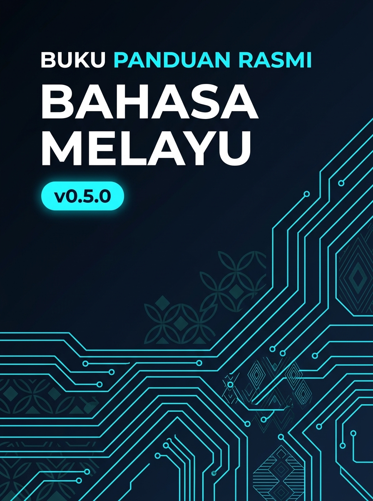
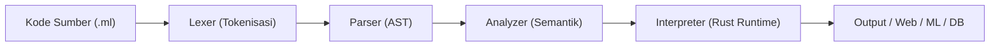

<div align="center">



<br/><br/>


# BUKU PANDUAN RESMI BAHASA PEMROGRAMAN MELAYU

**Edisi Lengkap v0.5.0 — Dari Nol sampai Full-Stack Web, Database, & Machine Learning**

*Ditulis untuk pembangun Indonesia, Malaysia, Brunei, dan Singapura.*  
*Dibangun dengan Rust | Lisensi MIT*

[Baca dalam Bahasa Inggris (English Version)](MANUAL_BOOK_EN.md) &bull; [Kembali ke README](../README.md)

</div>

---

## Halaman Utama Buku & Daftar Isi

Selamat datang di **Buku Panduan Resmi Bahasa Pemrograman MELAYU (`.ml`)**. Buku ini dirancang supaya siapa pun—baik pemula yang baru belajar logika pemrograman maupun developer berpengalaman—bisa langsung memahami cara kerja MELAYU dari dasar hingga membangun aplikasi web dan AI tanpa harus menghafal sintaks bahasa asing.

### Daftar Isi

- [Bab 1: Mengenal Bahasa MELAYU & Arsitekturnya](#bab-1-mengenal-bahasa-melayu--arsitekturnya)
- [Bab 2: Instalasi, CLI, & Taman Permainan](#bab-2-instalasi-cli--taman-permainan)
- [Bab 3: Dasar Bahasa (Variabel, Tipe Data, Operator, I/O)](#bab-3-dasar-bahasa-variabel-tipe-data-operator-io)
- [Bab 4: Percabangan & Perulangan](#bab-4-percabangan--perulangan)
- [Bab 5: Fungsi, Pipeline, Null-Safety, & Penanganan Error](#bab-5-fungsi-pipeline-null-safety--penanganan-error)
- [Bab 6: Koleksi (`senarai` & `kamus`) dan Metode Bawaan](#bab-6-koleksi-senarai--kamus-dan-metode-bawaan)
- [Bab 7: Pemrograman Berorientasi Objek (OOP)](#bab-7-pemrograman-berorientasi-objek-oop)
- [Bab 8: Sistem Modul, Pengujian (`uji`), & Manajemen Proyek](#bab-8-sistem-modul-pengujian-uji--manajemen-proyek)
- [Bab 9: AkalML & Tensor Native (Machine Learning & Deep Learning)](#bab-9-akalml--tensor-native-machine-learning--deep-learning)
- [Bab 10: Selasih Web Framework & Klien HTTP/HTTPS](#bab-10-selasih-web-framework--klien-httphttps)
- [Bab 11: Pangkalan Database JSON Terbenam](#bab-11-pangkalan-database-json-terbenam)
- [Bab 12: Keamanan, Sandbox, & Batas Enjin](#bab-12-keamanan-sandbox--batas-enjin)
- [Lampiran: Tabel Referensi Cepat](#lampiran-tabel-referensi-cepat)

---

## Bab 1: Mengenal Bahasa MELAYU & Arsitekturnya

**Kenapa MELAYU dibuat?**  
Banyak orang kesulitan belajar algoritma bukan karena logikanya susah, tetapi karena harus menerjemahkan kata kunci bahasa Inggris sambil memahami konsep baru. **MELAYU** hadir dengan kata kunci serumpun Nusantara (`ada`, `jika`, `selagi`, `kerja`, `pulang`, `selesai`) yang berjalan di atas interpreter Rust yang aman dan cepat.

Selain untuk belajar dasar pemrograman, MELAYU `v0.5.0` sudah dilengkapi tiga kerangka kerja bawaan di folder `std/`:
1. **`akal`** (`AkalML`): Machine Learning, Deep Learning, NLP TF-IDF, dan `Tensor` native.
2. **`selasih`**: Web server HTTP, REST API, middleware, CORS, serta klien HTTP/HTTPS.
3. **`pangkalan`**: Database JSON lokal yang patuh pada sandbox proyek.

### Alur Kerja Enjin MELAYU



---

## Bab 2: Instalasi, CLI, & Taman Permainan

### 2.1 Membangun dari Kode Sumber

Pastikan Rust (minimal versi `1.75`) sudah terpasang di sistem Anda:

```bash
git clone https://github.com/rillardian655/Melayu-Language-by-runa.git
cd Melayu-Language-by-runa
cargo build --release
```

Biner hasil kompilasi berada di `target/release/melayu`. Jika ingin build tanpa dependensi TLS/HTTPS, gunakan:

```bash
cargo build --release --no-default-features
```

### 2.2 Perintah CLI Utama

| Perintah | Kegunaan | Contoh |
| :--- | :--- | :--- |
| `melayu` | Membuka mode interaktif (REPL) | `melayu` |
| `melayu <fail.ml>` | Menjalankan skrip `.ml` | `melayu examples/fizzbuzz.ml` |
| `melayu jalankan <fail.ml>` | Alias eksplisit untuk menjalankan skrip | `melayu jalankan app.ml` |
| `melayu semak <fail.ml>` | Memeriksa sintaks & semantik tanpa eksekusi | `melayu semak app.ml` |
| `melayu format <fail.ml>` | Merapikan indentasi (4 spasi) | `melayu format app.ml` |
| `melayu format <fail.ml> --semak` | Mengecek apakah file sudah rapi | `melayu format app.ml --semak` |
| `melayu uji <fail.ml>` | Menjalankan blok pengujian `uji ... semak` | `melayu uji tes.ml` |
| `melayu tanda-aras <fail.ml> [n]` | Mengukur kecepatan eksekusi (`n` kali) | `melayu tanda-aras app.ml 10` |
| `melayu mula [nama] [--mvc]` | Membuat proyek baru (`pakej.json` / MVC) | `melayu mula webku --mvc` |
| `melayu taman [port]` | Membuka Web Playground lokal (default `7878`) | `melayu taman 7878` |
| `melayu bantuan` | Menampilkan daftar perintah CLI | `melayu bantuan` |

### 2.3 Contoh Output CLI

```text
$ melayu examples/papan_pemuka_ai.ml
==========================================================
   PAPAN PEMUKA AI FULL-STACK: SELASIH + HTML/CSS/JS
==========================================================
[1/3] Model RangkaianAdam sedia (Akurasi: 99%)
[2/3] Ujian inferens & simpan DB: Virginica (Jumlah rekod: 1)
[3/3] Papan pemuka web siap dihidupkan melalui app.dengar() pada port 8095.
```

---

## Bab 3: Dasar Bahasa (Variabel, Tipe Data, Operator, I/O)

### 3.1 Variabel (`ada`) dan Konstanta (`tetap`)

Gunakan `ada` untuk nilai yang boleh berubah, dan `tetap` untuk nilai tetap yang tidak boleh diubah ulang. Anotasi tipe bersifat opsional.

```melayu
ada nama = "Raka"
ada umur = 20
tetap PI = 3.14159

# Dengan anotasi tipe opsional
ada tinggi: nombor = 172.5
ada kota: teks = "Bandung"
ada aktif: betul = betul
```

### 3.2 Tipe Data Bawaan

| Tipe | Contoh Nilai | Keterangan |
| :--- | :--- | :--- |
| `nombor` | `42`, `3.14`, `1e21`, `5.9e-05` | Angka floating-point 64-bit (`f64`) |
| `teks` | `"Halo Dunia"` | Rentetan karakter UTF-8 |
| `betul` / `salah` | `betul`, `salah` | Nilai boolean (`true` / `false`) |
| `kosong` | `kosong` | Nilai hampa / null |
| `senarai` | `[10, 20, 30]` | Daftar berindeks (mendukung indeks negatif `s[-1]`) |
| `kamus` | `{"nama": "Siti", "umur": 22}` | Pasangan kunci-nilai (urutan kunci terjaga) |
| `Tensor` | `tensor([[1, 2], [3, 4]])` | Array numerik multidimensi untuk komputasi cepat |

### 3.3 Operator Kata vs Simbol

MELAYU membolehkan Anda memakai kata berbahasa Melayu maupun simbol standar:

- **Aritmetika**: `tambah` (`+`), `tolak` (`-`), `kali` (`*`), `bahagi` (`/`) , `modulo` (`%`), `@` (perkalian matriks/tensor).
- **Perbandingan**: `sama dengan` (`==`), `tidak sama` (`!=`), `lebih` (`>`), `kurang` (`<`), `lebih sama` (`>=`), `kurang sama` (`<=`).
- **Logika**: `dan` (`&&`), `atau` (`||`), `bukan` (`!`).

### 3.4 Input & Output Terminal

```melayu
tunjuk "Siapa nama kamu?"
ada nama = baca()
tunjuk "Berapa umur kamu?"
ada umur = baca nombor()

tunjuk "Halo " + nama + ", umur kamu " + teks(umur) + " tahun."
```

---

## Bab 4: Percabangan & Perulangan

Semua blok di MELAYU ditutup dengan kata kunci `selesai` (tidak memakai kurung kurawal `{}` untuk blok kontrol).

### 4.1 Percabangan `jika`

```melayu
ada nilai = 85

jika nilai lebih sama 90
    tunjuk "Gred A"
jika tidak jika nilai lebih sama 75
    tunjuk "Gred B"
jika tidak
    tunjuk "Perlu belajar lagi"
selesai
```

### 4.2 Pattern Matching `padan ... bila ... lain`

Lebih ringkas daripada rantai `jika tidak jika` saat mencocokkan banyak nilai:

```melayu
ada hari = "Sabtu"

padan hari
    bila "Sabtu" => tunjuk "Akhir pekan!"
    bila "Ahad" => tunjuk "Hari santai!"
    lain => tunjuk "Hari kerja."
selesai
```

### 4.3 Perulangan (`selagi` dan `untuk`)

```melayu
# 1. Perulangan selagi (while)
ada i = 1
selagi i kurang sama 3
    tunjuk "Hitungan:", i
    i = i + 1
selesai

# 2. Perulangan rentang (range) dengan langkah opsional
untuk x dari 0 hingga 10 langkah 2
    jika x == 4
        teruskan
    selesai
    jika x == 8
        hentikan
    selesai
    tunjuk x
selesai

# 3. Perulangan elemen (for-each)
ada buah = ["mangga", "durian", "rambutan"]
untuk item dalam buah
    tunjuk "Buah:", item
selesai
```

---

## Bab 5: Fungsi, Pipeline, Null-Safety, & Penanganan Error

### 5.1 Fungsi (`kerja` & `pulang`)

```melayu
kerja hitungLuas(panjang_sisi, lebar)
    pulang panjang_sisi * lebar
selesai

tunjuk "Luas:", hitungLuas(5, 4)
```

### 5.2 Operator Pipeline (`|>` atau `alir`)

Mengalirkan hasil suatu ekspresi langsung menjadi argumen pertama fungsi berikutnya:

```melayu
kerja tambahLima(n)
    pulang n + 5
selesai

kerja kaliDua(n)
    pulang n * 2
selesai

ada hasil = 10 |> tambahLima |> kaliDua
tunjuk hasil   # 30
```

### 5.3 Null-Safety (`??` dan `?.`)

```melayu
ada profil = {"nama": "Budi", "alamat": kosong}

# ?? memberi nilai cadangan jika sisi kiri bernilai kosong
ada kota = profil["alamat"] ?? "Belum diisi"
tunjuk kota

# ?. mengakses properti dengan aman tanpa error jika objeknya kosong
ada namaKota = profil["alamat"]?.kota ?? "Tidak diketahui"
tunjuk namaKota
```

### 5.4 Penanganan Error (`cuba ... tangkap ... akhirnya`)

```melayu
cuba
    ada angka = 10 / 0
    tunjuk angka
tangkap ralat
    tunjuk "Terjadi error:", ralat
akhirnya
    tunjuk "Blok pembersihan selalu dijalankan."
selesai
```

Anda juga dapat melempar error secara manual dengan `baling "Pesan error khusus"`.

---

## Bab 6: Koleksi (`senarai` & `kamus`) dan Metode Bawaan

### 6.1 Senarai & Pemrosesan Fungsional

```melayu
ada angka = [5, 2, 8, 1, 4]
angka.tambah(10)
angka.isih()                  # [1, 2, 4, 5, 8, 10]

kerja genap(x) pulang x % 2 == 0 selesai
kerja ganda(x) pulang x * 2 selesai

ada hasil = angka.tapis(genap).petakan(ganda)
tunjuk hasil.cantum(" - ")    # "4 - 8 - 16 - 20"
```

Metode `senarai` lainnya: `.buang(indeks)`, `.panjang()`, `.berisi(item)`, `.balik()`, `.kiraSemua(fn, awal)`, `.cari(fn)`, `.indeks(item)`, `.setiapSatu(fn)`.

### 6.2 Kamus (Dictionary)

Kamus di MELAYU menjaga urutan masuk (*insertion order*) secara konsisten:

```melayu
ada user = {"nama": "Ayu", "peran": "Admin"}
tunjuk user.adaKunci("nama")  # betul
tunjuk user.kunci()           # ["nama", "peran"]
tunjuk user.nilai()           # ["Ayu", "Admin"]
user.buang("peran")
```

### 6.3 Metode Teks

`teks` mendukung: `.pecah(pemisah)`, `.ganti(lama, baru)`, `.mulaDengan(awalan)`, `.tamatDengan(akhiran)`, `.mengandungi(sub)`, `.hurufBesar()`, `.hurufKecil()`, `.panjang()`, `.potong()`, `.ulang(n)`, `.selitDepan(p, aksara?)`, `.selitBelakang(p, aksara?)`, `.hurufAwalBesar()`.

---

## Bab 7: Pemrograman Berorientasi Objek (OOP)

MELAYU mendukung OOP penuh dengan kata kunci `kelas`, `bina` (constructor), `diri` (`this`/`self`), `warisi` (`extends`), dan `induk` (`super`).

```melayu
kelas Kendaraan
    bina(merk, tahun)
        diri.merk = merk
        diri.tahun = tahun
    selesai

    kerja info()
        pulang diri.merk + " (" + teks(diri.tahun) + ")"
    selesai
selesai

kelas MobilListrik warisi Kendaraan
    bina(merk, tahun, baterai)
        induk.bina(merk, tahun)
        diri.bateri = baterai
    selesai

    kerja info()
        pulang induk.info() + " - Baterai " + teks(diri.bateri) + "%"
    selesai
selesai

ada mobil = MobilListrik("Proton e.MAS", 2026, 95)
tunjuk jenis(mobil)   # "MobilListrik"
tunjuk mobil.info()   # "Proton e.MAS (2026) - Baterai 95%"
```

---

## Bab 8: Sistem Modul, Pengujian (`uji`), & Manajemen Proyek

### 8.1 Tiga Cara Impor Modul (`ambil`)

```melayu
# 1. Impor seluruh simbol ke ruang lingkup aktif
ambil "pembantu.ml"

# 2. Impor ke dalam namespace kamus
ambil "matematika.ml" sebagai mat
tunjuk mat.tambahDua(10)

# 3. Impor fungsi tertentu saja
ambil kiraDiskon, cekStok daripada "toko.ml"
```

### 8.2 Pengujian Bawaan (`uji ... semak`)

Jalankan file pengujian dengan perintah `melayu uji nama_file.ml`:

```melayu
uji "penjumlahan dasar"
    ada hasil = 2 + 3
    semak hasil == 5
selesai
```

### 8.3 Proyek dengan `pakej.json`

Menjalankan `melayu mula proyek_ku` membuat file `pakej.json`. Keberadaan `pakej.json` otomatis menjadi batas akar sandbox file proyek Anda.

---

## Bab 9: AkalML & Tensor Native (Machine Learning & Deep Learning)

### 9.1 Primitif `Tensor` & Operator `@`

`Tensor` mendukung perkalian matriks native `@`, broadcasting bias, serta aktivasi cepat:

```melayu
ada X = tensor([[1.0, 2.0], [3.0, 4.0]])
ada W = rawakTensor([2, 2])
ada b = sifarTensor([2])

ada Z = ((X @ W) + b).relu()
tunjuk Z.bentuk()
tunjuk Z.purata()
```

Metode `Tensor`: `.bentuk()`, `.jumlah()`, `.purata()`, `.transposisi()`, `.sigmoid()`, `.relu()`, `.ubahBentuk(bentuk_baru)`.

### 9.2 Daftar Kelas di `ambil "akal"`

| Kategori | Kelas / Fungsi Utama |
| :--- | :--- |
| **Regresi & Klasifikasi** | `RegresiLinear`, `PengelasKNN`, `PengelasBayesNaif`, `PokokKeputusan`, `HutanRawak` |
| **Clustering** | `PengelompokanKMeans` |
| **Deep Learning** | `JaringanSaraf`, `LapisanLinear`, `RangkaianAdam` |
| **Data & Preprocessing** | `JadualData`, `SkalaMinMaks`, `PenyelarasanPiawai`, `PengkodLabel`, `PengkodSatuPanas` |
| **NLP & Validasi** | `PengiraTFIDF`, `kesamaanCosine`, `bahagiLatihUji`, `pengesahanSilang`, `benihRawak` |
| **Dataset Bawaan** | `muatIris()` (150 baris), `muatKredit()`, `janaDataSintetik()` |

### 9.3 Akselerasi GPU & Batas Langkah ML

- Cek perangkat keras: `infoPerkakas()` (menampilkan `teras_cpu` dan `ketepatan_gpu`).
- Mode GPU: set `MELAYU_GPU=fp32` untuk komputasi FP32 di GPU (CUDA/ROCm pada Linux), atau `MELAYU_GPU=0` untuk memaksa CPU FP64.
- Dataset besar: jalankan dengan `--had-langkah 0` atau `MELAYU_HAD_LANGKAH=0` agar tidak terhenti di batas 10 juta langkah.

---

## Bab 10: Selasih Web Framework & Klien HTTP/HTTPS

Dengan `ambil "selasih"`, MELAYU bisa langsung menjadi backend web server atau REST API untuk frontend HTML/CSS/JS maupun React Native.

```melayu
ambil "selasih"

kerja beranda(req)
    pulang balasHTML("<h1>Halo dari Selasih!</h1>", 200)
selesai

kerja apiSimpan(req)
    ada data = req.json()
    pulang balasJSON({"diterima": data}, 200)
selesai

ada app = PelayanWeb(8080)
app.guna(pengantaraLogger)
app.guna(pengantaraKeselamatan)
app.dapatkan("/", beranda)
app.hantar("/api/simpan", apiSimpan)
app.dengar()
```

**Fitur Penting `Selasih`:**
- Routing: `.dapatkan()`, `.hantar()`, `.kemaskini()`, `.padam()`.
- Pembantu respons: `balasHTML(html, status)`, `balasJSON(data, status)`, `balasTeks(teks, status)`, `balasCORS(status)`, `selitHTML(input)` (anti-XSS).
- Klien keluar: `hantarPermintaanHTTP(kaedah, url, kepala?, badan?)` mendukung `http://` dan `https://` (`rustls`).
- Lihat contoh aplikasi lengkap di [papan_pemuka_ai.ml](../examples/papan_pemuka_ai.ml) dan [servis_ai_pangkalan.ml](../examples/servis_ai_pangkalan.ml).

---

## Bab 11: Pangkalan Database JSON Terbenam

Modul `ambil "pangkalan"` menyimpan data terstruktur ke file JSON secara otomatis dengan `_id` unik dan tetap mematuhi sandbox proyek.

```melayu
ambil "pangkalan"

ada db = Pangkalan("toko.json")
db.ciptaJadual("produk")
db.sisip("produk", {"nama": "Kopi Arabika", "harga": 35000})

ada hasil = db.cariSatu("produk", {"nama": "Kopi Arabika"})
tunjuk hasil["harga"]

db.kemaskini("produk", {"nama": "Kopi Arabika"}, {"harga": 38000})
db.padam("produk", {"nama": "Kopi Arabika"})
```

Metode lain: `.cari(jadual, syarat)`, `.cariSemua(jadual)`, `.bilang(jadual)`, `.senaraiJadual()`, `.padamJadual(jadual)`.

---

## Bab 12: Keamanan, Sandbox, & Batas Enjin

MELAYU dirancang aman secara default (*safe by default*):

| Komponen | Batas Default | Cara Mengubah / Catatan |
| :--- | :--- | :--- |
| Kedalaman Rekursi | `1_000` panggilan | Mencegah stack overflow |
| Langkah Eksekusi | `10_000_000` langkah | `--had-langkah <n>` atau `MELAYU_HAD_LANGKAH=<n>` (`0` = tanpa batas) |
| Panjang Teks Maks | `16 MB` | `HAD_SAIZ_TEKS_MAKSIMUM` |
| Elemen Senarai / Tensor | `1_000_000` elemen | `HAD_ELEMEN_SENARAI_MAKSIMUM` / `HAD_ELEMEN_TENSOR_MAKSIMUM` |
| File I/O (`bacaFail`/`tulisFail`) | `5 MB` | Dibatasi ke folder sandbox proyek (`--sandbox` / `MELAYU_SANDBOX`) |
| Tampilan / JSON | `64 MB` | Mencegah ledakan memori pada nilai siklik |
| HTTP Server | Header `16 KB`, Badan `1 MB` | Koneksi klien berjalan di thread terpisah |
| Anti-Path Traversal & Symlink | Aktif | Menolak akses file sensitif (`.env`, `.aws`, `.git-credentials`, dll.) |
| Anti-SSRF | Aktif | Memblokir IP link-local & cloud metadata pada semua format IP |

---

## Lampiran: Tabel Referensi Cepat

- **Panduan Modul Terpisah**: [akalml.md](akalml.md) &bull; [selasih.md](selasih.md) &bull; [pangkalan.md](pangkalan.md)
- **Daftar Error & Glosari**: [senarai_ralat.md](senarai_ralat.md) &bull; [glosari_istilah.md](glosari_istilah.md)
- **Contoh Kode**: Folder [examples/](../examples/)
