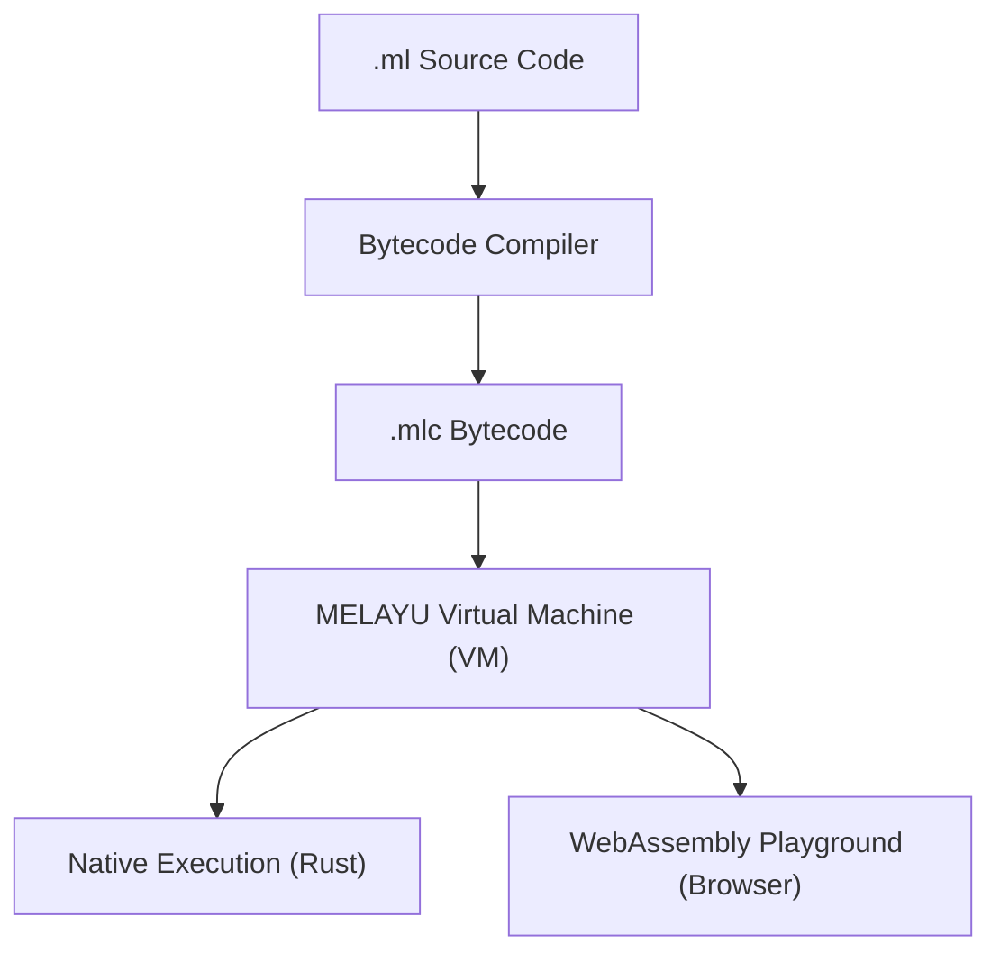

# Pelan Hala Tuju Seni Bina Enjin v1.0.0 (Roadmap Specification)

Spesifikasi ini menggariskan hala tuju transformasi enjin MELAYU ke arah versi **v1.0.0** berprestasi tinggi dan sokongan ekosistem penuh.

## Komponen Teras Sasaran v1.0.0

### 1. Enjin Virtual Machine (VM) Berasaskan Bytecode
* Menggantikan kaedah tafsiran AST *tree-walking* sedia ada kepada penterjemah bytecode *stack-based / register-based*.
* Peningkatan kelajuan pelaksanaan sehingga 10x - 25x lebih pantas.
* Menghasilkan format binari kompak `.mlc` (*Melayu Compiled Bytecode*).

### 2. Pustaka Piawai Standard (Melayu Standard Library)
* `std/matematik`: Trigonometri (sin, cos, tan), logaritma, matriks.
* `std/rentetan`: Ekspresi nalar (*Regular Expressions* / regex serumpun).
* `std/masa`: Format tarikh kalendar Hijriah & kalendar sivil serumpun.
* `std/jaringan`: Sokongan permintaan HTTP asas (GET, POST).

### 3. Taman Permainan Web Interaktif (WebAssembly / WASM)
* Mengkompil enjin `melayu_core` kepada sasaran `wasm32-unknown-unknown`.
* Membolehkan kod MELAYU ditulis, diuji, dan dijalankan secara langsung dalam pelayar web tanpa perlu memasang CLI.
* Integrasi bersama visualisasi langkah pengaturcaraan untuk pembelajaran di sekolah dan universiti.

### 4. Pengurus Pakej Rasmi (`rempah`)
* Sistem perkongsian modul dan pakej komuniti serumpun.
* Pengurusan kebergantungan (*dependency resolution*) berautomasi selamat.
